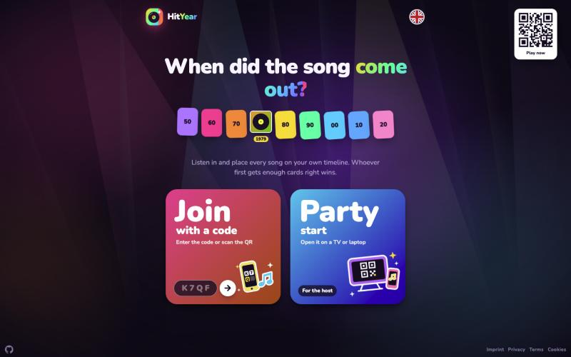
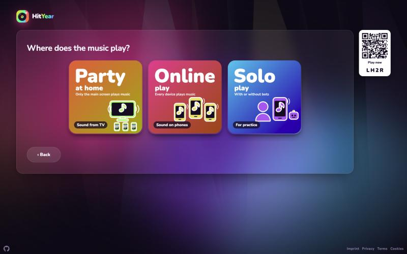
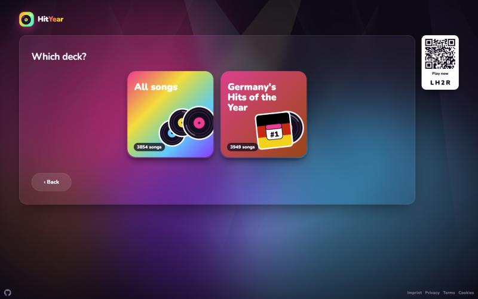
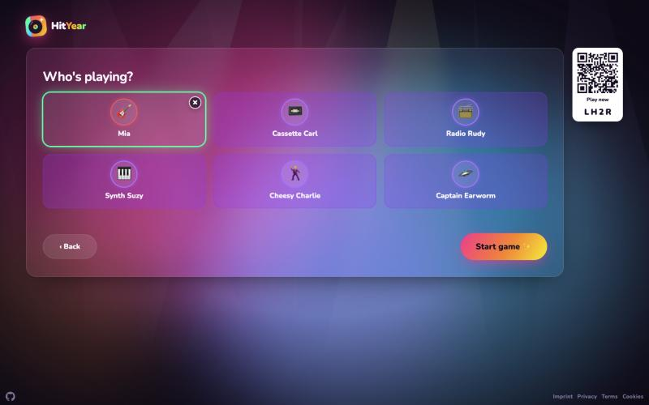
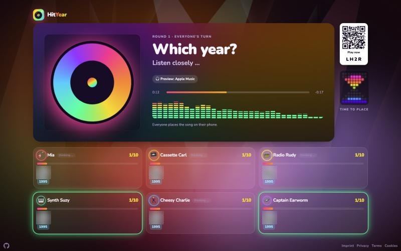
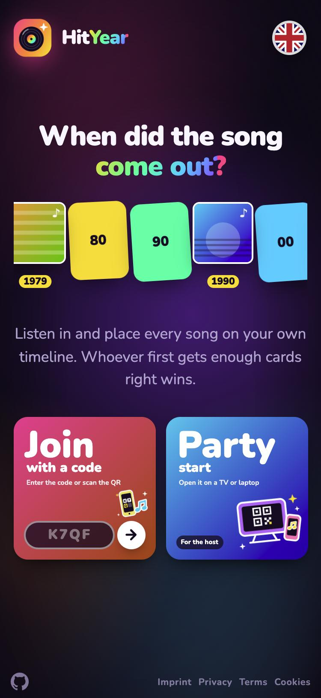
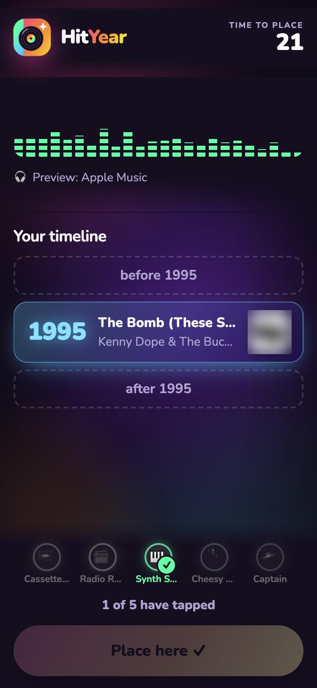

# 🎵 HitYear – Musik-Partyspiel

[English](README.md) · **Deutsch**



**Wann kam der Song raus?** Ein Ausschnitt läuft, alle hören rein und sortieren den Song am Handy nach seinem Erscheinungsjahr in den eigenen Zeitstrahl. Wer zuerst genug Karten richtig liegen hat, gewinnt.

- 1–6 Spielerinnen und Spieler, jede Person mit dem eigenen Handy – oder allein gegen KI-Bots üben: QR-Code scannen oder Code eingeben, ohne App. Optional schützt ein gemeinsames Passwort die ganze App; per QR-Code geht es ohne.
- Ein Hauptbildschirm (TV, Laptop, Beamer) zeigt QR-Code, Musik-Player, Mitspieler und die Auflösung.
- Die Musik kommt als 30-Sekunden-Hörprobe, die der Browser **direkt von Deezer** streamt (Apple Music als Ausweichquelle) – der Server speichert keine Musik. Optional eigene Sammlung, aus der der Server kurze Ausschnitte schneidet.
- Oberfläche in 🇩🇪 Deutsch, 🇬🇧 English, 🇫🇷 Français, 🇮🇹 Italiano, 🇪🇸 Español und 🇧🇷 Português (Brasil).

Spielen: <https://hityear.app> · Repo: <https://github.com/WTK1611/hityear> · Lizenz: [PolyForm Noncommercial 1.0.0](LICENSE.md) (frei nutzbar, änderbar, weitergebbar – **nicht kommerziell**) · [Mitmachen erwünscht](CONTRIBUTING.md)

## Bilder

| Einrichtung: Wo läuft die Musik? | Deck wählen |
|---|---|
|  |  |
| **Lobby: Mitspieler und KI-Bots** | **Runde am Hauptbildschirm** |
|  |  |

| Handy: Startseite | Handy: eigener Zeitstrahl |
|---|---|
|  |  |

---

## Spielregeln

1. **Start:** Jede Person bekommt eine aufgedeckte Startkarte (Song mit Jahr) in ihren Zeitstrahl.
2. **Hören:** Nach einem Countdown (3 · 2 · 1) läuft auf allen Geräten gleichzeitig ein Ausschnitt.
3. **Einordnen:** Im eigenen Zeitstrahl die Lücke antippen, in die der Song gehört, und bestätigen. Gleiches Jahr wie eine Nachbarkarte zählt als richtig.
4. **Auflösung:** Titel, Interpret, Jahr und Cover erscheinen. Wer richtig lag, bekommt die Karte in den Zeitstrahl.
5. **Zusatzpunkte ⭐ (optional):** Nach dem Jahr zusätzlich Titel und Interpret raten. Jeder Treffer gibt einen Stern.
6. **Sieg:** Wer die Zielzahl an Karten (10, 15 oder 20) erreicht, gewinnt sofort. Bei Gleichstand entscheiden die ⭐; sind auch die gleich, gewinnen alle Führenden gemeinsam.
7. Nach der Auflösung geht es nach 10 Sekunden automatisch weiter. Überspringen gibt es nicht, damit alle die Auflösung gleich lang sehen.

### Einrichtung Schritt für Schritt

Der Hauptbildschirm stellt pro Schritt eine Frage, die Antworten sind große Kacheln (am Handy zwei pro Reihe). Der QR-Code steht schon ab dem ersten Schritt daneben, Mitspieler können also beitreten, während eingerichtet wird.

| Schritt | Optionen |
|---|---|
| Wo läuft die Musik? | **Party vor Ort** (Ton vom TV, Handys nur zum Tippen) · **Online** (jedes Handy spielt die Musik, auch an verschiedenen Orten; der Gastgeber kann auf demselben Gerät mitspielen) · **Allein** (zum Üben, mit oder ohne Bots) |
| Wer ist dran? | alle gleichzeitig · reihum einer |
| Wann endet eine Runde? (alle gleichzeitig) | nach ganzer Hörprobe (30 s) · 5 s nach allen Antworten · 5 s ab der ersten Antwort |
| Was wird geraten? | nur das Jahr · Jahr + Songtitel & Interpret (Bonus-Sterne) |
| Karten zum Sieg | 10 · 15 · 20 |
| Deck | alle Songs oder ein Deck, danach nach Jahrzehnten und Genres filtern (Mehrfachauswahl; *Weiter* erst, wenn Songs übrig bleiben) |
| KI-Bots | freie Plätze bis 6 mit Bots auffüllen; Name und Stärke (leicht, mittel, Profi) würfelt die App. In der Lobby entfernt ein Klick einen Bot oder holt ihn zurück, echte Spieler übernehmen Bot-Plätze |
| Toleranz pro Person | exakt · ±1 · ±2 · ±3 · ±5 Jahre (für Kinder oder Einsteiger; in der Lobby antippen) |

---

## Funktionen

| Bereich | Was es kann |
|---|---|
| **Beitreten** | Raumcode (4 Zeichen, verwechslungsarm: S/5, Z/2, B/8 werden toleriert) oder QR-Code mit Einladungs-Token; Kamera-Scan auf der Startseite |
| **Synchron spielen** | Server-autoritativer Zustand, gemeinsamer Startzeitpunkt auf der Serveruhr, Uhrabgleich per Ping, Stand-Nummer mit Abgleich alle 2 s samt Lebenszeichen (ohne Antwort → sofort neu verbinden), gezielte Nachfrage zu Auflösung und nächstem Song, Handshake vor jedem Songwechsel (höchstens 10 s „Warte auf …“), Hinweis bei Verbindungsverlust |
| **Handy-Leistung** | Aufwendiger animierter Hintergrund nur am Hauptbildschirm; Handys bekommen einen ruhenden Verlauf ohne Weichzeichner (der teure Hintergrund ließ iPhones bei jedem Songwechsel 10–27 s einfrieren) |
| **Fehlersuche** | Geräte melden Hänger der Seite, Trennungen und ausbleibende Antworten ins Server-Log (`[diagnose]`, `[verbindung]`, `[bereit]`) |
| **Rechtliches** | Impressum, Datenschutz, Nutzungsbedingungen (AGB), Links in der Fußzeile; anonyme Statistik (Matomo auf eigenem Server) nur mit Einwilligung, auf der Cookie-Seite widerrufbar |
| **Suchmaschinen** | Startseite und „So geht's“ sind indexierbar (`robots.txt`, `sitemap.xml`, `llms.txt`); API, Räume, Hauptbildschirm, Handy und Bibliothek senden `noindex` |
| **Startseite** | Zwei quadratische Kacheln: *Spielen mit Code* (Code-Feld direkt auf der Kachel, eigene Fehlermeldung) und *Party starten*; am Handy nebeneinander |
| **Einrichtung** | Geführte Einrichtung mit Kacheln (Verlauf, Aufkleber-Bild, Schatten), Partikel bei jedem Tipp, Decks als Plattenhüllen, die aus dem Namen gestaltet sind (Flagge, Symbol), Startkarte wird vor dem ersten Song aufgedeckt |
| **Hauptbildschirm** | QR-Code, drehende Schallplatte, die im Bass vibriert, Equalizer in 9 Stilen (Klick oder ←/→ schaltet um), Fortschrittsleiste, Mitspieler-Raster mit Live-Status (überlegt, getippt, rät), Ergebnis-Banner mit Sternen, „+1“-Animationen, Konfetti, Bestenliste |
| **Handy** | Eigener Zeitstrahl zum Antippen, Countdown, geführtes Raten (Jahr → Interpret → Titel), Vibration, Bildschirm bleibt wach (Wake Lock) |
| **TV-tauglich** | Eigene Schrift (Nunito), SVG-Symbole statt Sonderzeichen, Abstand gegen Overscan, Bedienung mit der Fernbedienung durch alle Kacheln (Pfeiltasten + OK), passt ohne Scrollen auf 960×540, Sparmodus für Fernseher und alte Geräte (keine Dauer-Animationen, gedrosselter Equalizer) |
| **Anti-Schummeln** | Ausschnitte ohne Metadaten mit Einmal-URLs; Titel und Jahr kommen erst mit der Auflösung zum Gerät |
| **Audio** | Hörproben direkt von Deezer gestreamt (Apple Music als Ausweichquelle), mit Quellenhinweis; bei eigenen Dateien: Startpunkt zufällig bei 20–60 % der Songlänge, Ein- und Ausblenden, Lautstärke angeglichen (`loudnorm`) |
| **Bibliothek** | Vorschauen von Apple/Deezer als Einträge (keine Dateien), optional Scan eigener Dateien (MP3, M4A, FLAC, OGG, Opus), Jahr aus manueller Angabe > Songliste (Originaljahr) > Tag bzw. Apple/Deezer > Jahrescharts, Prüfliste, Duplikate, Songs ausschließen |
| **Decks** | Eigene Decks zusammenstellen; Playlists von Deezer/Apple Music oder eigene Songlisten (CSV) importieren |
| **Hintergrund** | Eigene Geschichten zum Song |
| **Sprachen** | 6 Sprachen; Umschalter mit Flaggen oben rechts auf der Startseite, sonst die Sprache des Browsers |
| **App-Gefühl** | Web-App-Manifest und Icons (zum Home-Bildschirm hinzufügen) |
| **Marketing** | `/marketing`: Bilder (Quadrat, Story, Link-Vorschau; DE/EN) und fertige Posttexte für soziale Netzwerke |

---

## Architektur

```
 Handys (1–6)            Hauptbildschirm (TV/Laptop)        Bibliothek (Browser)
 /spielen.html           /host.html                         /admin.html
      │  Socket.IO + HTTPS      │                                  │
      └───────────────┬─────────┴──────────────────────────────────┘
                      ▼
              Reverse Proxy (z. B. Caddy) · TLS
                      ▼
 ┌──────────────── Docker-Container ─────────────────────────────┐
 │ Node.js ≥ 22.18 (TypeScript direkt, ohne Build)                │
 │  ├─ HTTP: Seiten, JSON-API, Audio (Range), Cover, QR           │
 │  ├─ Socket.IO: Räume, Zustand pro Gerät gefiltert              │
 │  ├─ Spiel-Engine: reine Zustandsmaschine (game.ts)             │
 │  ├─ Bibliothek: Scan, Tags, Jahresermittlung, Decks            │
 │  ├─ Hörproben: Weiterleitung zu Apple Music/Deezer (nichts gespeichert) │
 │  └─ ffmpeg: Ausschnitte ohne Metadaten (nur eigene Dateien)    │
 │ SQLite (node:sqlite, WAL) + Ausschnitt-Cache → Volume /daten   │
 │ Musik (nur lesen) → /musik                                     │
 └────────────────────────────────────────────────────────────────┘
```

| Ebene | Wahl |
|---|---|
| Server | Node.js ≥ 22.18, TypeScript (strict, ohne Build-Schritt), `node:http` ohne Framework |
| Echtzeit | Socket.IO 4 mit Verbindungs-Wiederherstellung (2 min) und Ping alle 5 s |
| Daten | SQLite über `node:sqlite` |
| Audio | ffmpeg (libmp3lame, loudnorm, afade) |
| Frontend | HTML, CSS und Vanilla-JS ohne Bundler; Übersetzung über `public/js/i18n.js` |
| Betrieb | Docker Compose hinter einem Reverse Proxy; Ausrollen per GitHub Actions |

### Module (`src/`)

| Datei | Aufgabe |
|---|---|
| `server.ts` | HTTP-Server, Routen, Sicherheits-Header, Start |
| `game.ts` | Spielregeln als reine Funktionen (beitreten, starten, legen, raten, auswerten, Sieg) |
| `raeume.ts` | Socket.IO-Ereignisse, Rollen, Zeitplan eines Zugs, Bots, Snapshot in SQLite |
| `bibliothek.ts` | Scan, Jahresregeln, Chart-Abgleich, Stapel ziehen |
| `audio.ts` | Ausschnitte schneiden, Einmal-Token, Cache |
| `apple.ts`, `deezer.ts` | Online-Vorschauen |
| `listen.ts`, `playlist.ts` | Songlisten und Decks |
| `auth.ts`, `bestenliste.ts`, `db.ts`, `config.ts`, `normalisieren.ts` | Anmeldung, Bestenliste, Schema, Konfiguration, Textabgleich |

### Frontend (`public/`)

| Datei | Aufgabe |
|---|---|
| `index.html` + `js/start.js` | Startseite: Code eingeben, QR scannen, Spiel erstellen, Sprachumschalter |
| `host.html` + `js/host.js` | Hauptbildschirm: geführte Einrichtung, Lobby, Player, Mitspieler, Auflösung |
| `spielen.html` + `js/spielen.js` | Handy: beitreten, einordnen, raten |
| `admin.html` + `js/admin.js` | Bibliothek, Decks (nur Deutsch) |
| `so-gehts.html`, `marketing.html` + `js/marketing.js` | Spielanleitung; Bilder und Posttexte zum Teilen |
| `js/gemeinsam.js` | Gemeinsame Bausteine: Socket, Uhrabgleich, Player, Equalizer, Countdown, Fernbedienung |
| `js/i18n.js` | Sprachen: übersetzt alle Texte der Seite über eine Tabelle (Deutsch → Zielsprache) |

Mehr dazu in [`docs/ARCHITEKTUR.md`](docs/ARCHITEKTUR.md).

---

## Lokal starten

Voraussetzungen: Node.js ≥ 22.18 und `ffmpeg`.

```bash
npm install
npm run testmusik   # Testsongs nach ./musik (oder eigene Musik dort ablegen)
npm run dev         # http://localhost:3700
```

Prüfen:

```bash
npm run typecheck && npm test
```

## Betrieb

- Docker-Image aus dem `Dockerfile`, Compose-Datei unter `deploy/`. Die Konfiguration kommt aus einer `.env` (Vorlage: [`deploy/.env.example`](deploy/.env.example)); `deploy/ausrollen.sh` erzeugt sie beim ersten Lauf mit zufälligen Werten.
- Der Container lauscht nur auf `127.0.0.1`; öffentlich erreichbar ist das Spiel nur über HTTPS hinter einem Reverse Proxy.
- Ausrollen: Push nach `main` → GitHub Actions prüft (`typecheck`, `test`) und rollt per SSH aus. SSH-Schlüssel und Host-Key stehen nur in den Repo-Secrets.
- Jahrescharts (optional, verbessern die Jahreserkennung) sind **nicht** im Repo. Eine CSV `charts*.csv` mit den Spalten `year,pos,artist,title` in den Ordner `charts` neben der Compose-Datei legen (eingebunden als `/charts`), lokal als `data/jahrescharts.csv`.
- Musik per `rsync` auf den Server kopieren (`deploy/musik-sync.sh`); der Dienst liest sie danach automatisch neu ein.
- Passwortpflicht: `ZEITSTRAHL_ZUGANG=passwort` in der `.env` → die App ist erst nach Eingabe von `ZEITSTRAHL_PASSWORT` (mind. 8 Zeichen) nutzbar; API, Audio und Echtzeitverbindung sind sonst gesperrt. QR-Einladungen und die Rechtsseiten bleiben frei.

## Mitmachen

Beiträge sind willkommen – siehe [CONTRIBUTING.md](CONTRIBUTING.md). Die Regeln in Kürze:

- Code, Kommentare und Commits auf **Deutsch**; Bezeichner ebenfalls deutsch (`spielerEntfernen`, `zugVorbereiten`).
- Keine Build-Schritte und keine Frontend-Frameworks: TypeScript läuft direkt in Node, das Frontend ist Vanilla-JS.
- Spielregeln gehören als reine Funktionen in `game.ts` und bekommen Tests in `test/`.
- Der Server entscheidet alles. Geräte bekommen nur, was sie sehen dürfen (`sicht()`).
- Neue Texte im Frontend auf Deutsch schreiben und in `public/js/i18n.js` für alle Sprachen ergänzen.
- Nie Passwörter, Schlüssel oder `.env`-Inhalte ins Repo, in Commits oder Logs.
- Vor jedem Push: `npm run typecheck && npm test`.

## Rechtliches (Kurzfassung, keine Rechtsberatung)

- Impressum, Datenschutz und Nutzungsbedingungen liegen unter `public/impressum.html`, `public/datenschutz.html`, `public/nutzungsbedingungen.html`.
- Hörproben kommen von Apple Music und Deezer unter deren Entwickler-Bedingungen: **nur nicht kommerziell und privat**. Keine Funktionen einbauen, die Hörproben speichern, mitschneiden oder umgehen.
- Eigene Dateien: nur rechtmäßig erworbene Musik. **Keine Musikdateien und keine Chartdaten sind Teil des Repos.**
- Ausgeliefert werden nur kurze Ausschnitte, keine ganzen Dateien. Suchmaschinen indexieren nur die Startseite und „So geht's“.
- Name und Logo „HitYear“ sind von der Lizenz nicht erfasst; keine fremden Marken.
- Schrift Nunito unter der [SIL Open Font License](public/fonts/OFL.txt).

## Lizenz

[PolyForm Noncommercial 1.0.0](LICENSE.md): Nutzen, Ändern und Weitergeben sind frei erlaubt, solange es **nicht kommerziell** ist (privat, Bildung, Vereine, gemeinnützige Zwecke). Für kommerzielle Nutzung bitte vorher anfragen: hityear@tobis.io.

© 2026 Tobias Kurig (medienguru.de)
