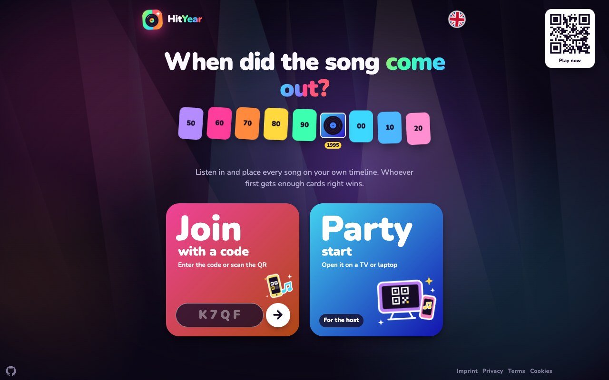
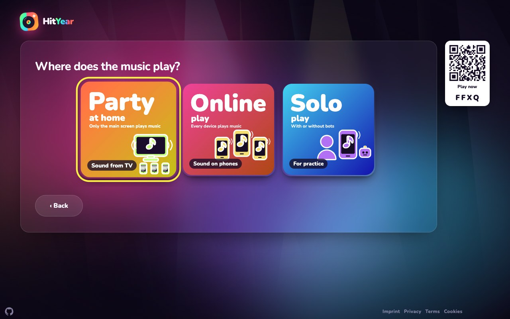
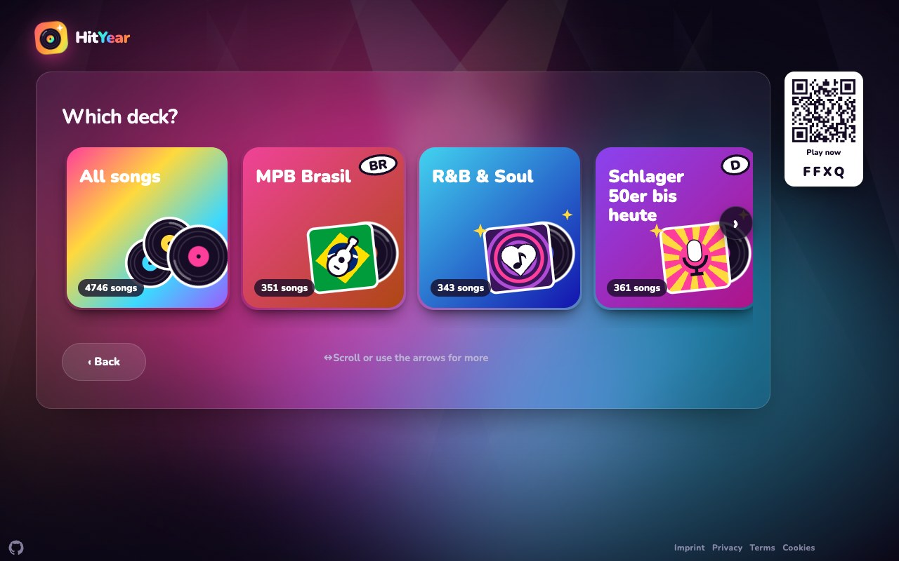
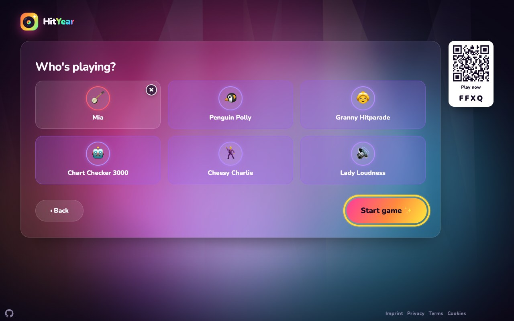
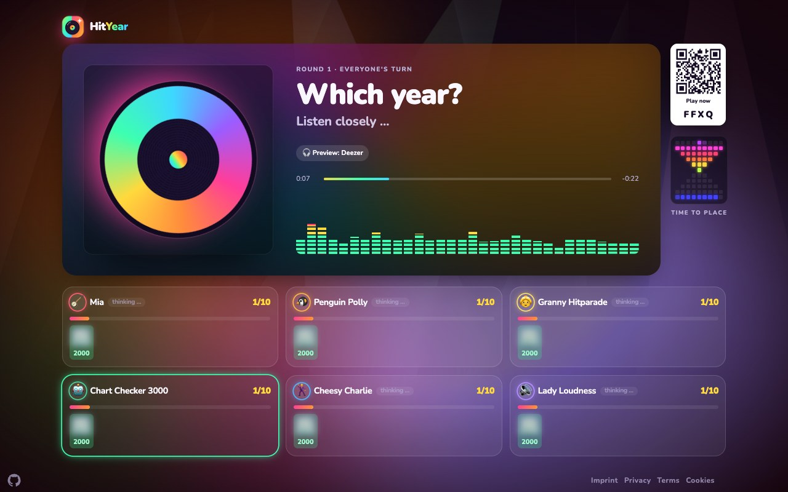
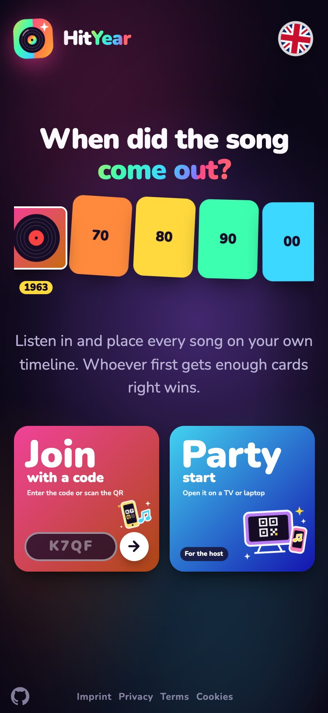
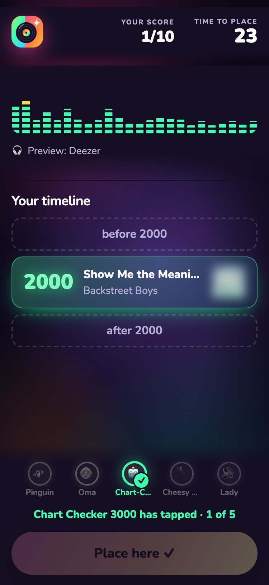
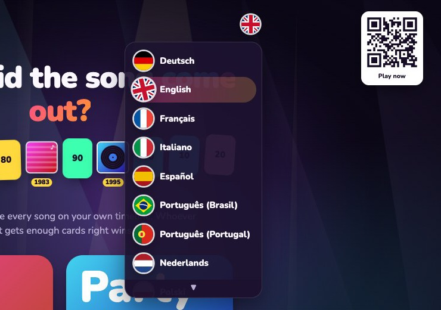
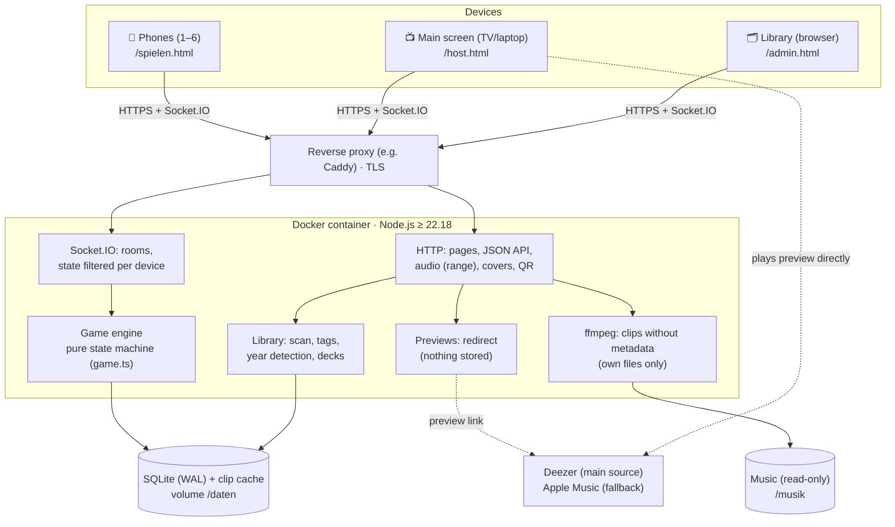

# 🎵 HitYear – Music Party Game

**English** · [Deutsch](README.de.md)



**When did the song come out?** A clip plays, everyone listens, and each player places the song on their phone into their own timeline by release year. The first to get enough cards in the right spot wins.

- 1–6 players, each on their own phone – or practise alone against AI bots: scan the QR code or type the room code. No app. Optionally a shared password protects the whole app; the QR code lets guests in without it.
- One main screen (TV, laptop, projector) shows the QR code, the music player, all players and the reveal.
- Music comes as 30-second previews that the browser streams **directly from Deezer** (Apple Music as a fallback) – the server stores no music. Optionally your own collection, from which the server cuts short clips.
- Interface in **29 languages** – Deutsch, English, Français, Italiano, Español, Português (Brasil and Portugal), Nederlands, Polski, Türkçe, Русский, Українська, Svenska, Norsk, Dansk, Suomi, Čeština, Slovenčina, Magyar, Română, Български, Ελληνικά, Hrvatski, Srpski, Shqip, Català, 日本語, עברית and العربية.

Play: <https://hityear.app> · Repo: <https://github.com/WTK1611/hityear> · License: [PolyForm Noncommercial 1.0.0](LICENSE.md) (free to use, modify and share – **not commercially**) · [Contributions welcome](CONTRIBUTING.md)

## Screenshots

| Setup: where does the music play? | Choosing a deck |
|---|---|
|  |  |
| **Lobby: players and AI bots** | **Round on the main screen** |
|  |  |

| Phone: home page | Phone: your timeline | Language menu (29 languages) |
|---|---|---|
|  |  |  |

---

## How to play

1. **Start:** Every player gets one face-up starting card (a song with its year) on their timeline.
2. **Listen:** After a countdown (3 · 2 · 1) a clip plays on all devices at the same moment.
3. **Place:** Tap the gap in your timeline where the song belongs and confirm. Same year as a neighbouring card counts as correct.
4. **Reveal:** Title, artist, year and cover appear. Whoever was right adds the card to their timeline.
5. **Bonus stars ⭐ (optional):** After the year, also guess the title and the artist. Each hit earns a star.
6. **Winning:** The first player to reach the target (10, 15 or 20 cards) wins right away. On a tie the ⭐ decide; if those are equal too, the leaders win together.
7. After the reveal the game moves on automatically after 10 seconds. There is no skipping, so everyone sees the reveal equally long.

### Setup step by step

The main screen asks one question per step, the answers are big tiles (on phones two per row). The QR code is visible from the first step, so players can join while you set up.

| Step | Options |
|---|---|
| Where does the music play? | **Party in the room** (sound from the TV, phones only tap) · **Online** (every phone plays the music, also from different places; the host can play on the same device) · **Solo** (practise alone, with or without bots) |
| Whose turn? | everyone at once · one player at a time |
| When does a round end? (everyone at once) | after the full preview (30 s) · 5 s after all answers · 5 s after the first answer |
| What do you guess? | year only · year + title & artist (bonus stars) |
| Cards to win | 10 · 15 · 20 |
| Deck | all songs or a deck, then filter by decades and genres (multiple choice; *Next* only once songs match) |
| AI bots | fill free seats up to 6 with bots; the app rolls name and strength (easy, medium, pro). In the lobby a click removes a bot or brings it back, and real players take over bot seats |
| Tolerance per player | exact · ±1 · ±2 · ±3 · ±5 years (for kids or beginners; tap it in the lobby) |

---

## Features

| Area | What it does |
|---|---|
| **Joining** | 4-character room code (S/5, Z/2, B/8 mix-ups are tolerated; no codes that read as rude words) or QR code with an invite token; camera scan on the home page; the code field also works with Cyrillic, Greek or Arabic keyboards (look-alike letters and digits are mapped, otherwise a hint asks to switch). Whoever joins during a round can still place the current song |
| **In sync** | Server-authoritative state, shared start time on the server clock, clock sync via ping, state counter checked every 2 s with a liveness reply (no reply → reconnect at once), targeted re-check at reveal and next song, handshake before every song change (at most 10 s “Waiting for …”), notice when the connection drops; if all players are offline the main screen counts down 15 s and continues, after 3 such rounds it pauses |
| **Phone performance** | The heavy animated background runs only on the main screen; phones get a calm static gradient without blur (the heavy background froze iPhones for 10–27 s at every song change) |
| **Debugging** | Devices report page freezes, disconnects and missing replies to the server log (`[diagnose]`, `[verbindung]`, `[bereit]`); the footer shows live games, app version (1.<number of commits>) and the detected device (tv/tb/sp/pc) |
| **Legal** | Legal notice, privacy policy, terms of use, footer links; anonymous statistics (self-hosted Matomo) only with consent, revocable on the cookie page |
| **Search engines** | Home page and “How to play” are indexable (`robots.txt`, `sitemap.xml`, `llms.txt`); API, rooms, main screen, phone and library send `noindex` |
| **Home page** | Two square tiles: *Join with a code* (code field right on the tile, own error message) and *Start a party*; on phones side by side |
| **Setup** | Guided setup with tiles (gradient, sticker image, shadow), a particle burst on every tap, decks as record sleeves designed from their name (flag, symbol), starting card revealed before the first song |
| **Main screen** | QR code, spinning record that shakes to the bass, equalizer in 20 styles (click or ←/→ switches), progress bar, player grid with live status (thinking, placed, guessing), reveal with genre tag and source link, result banners with stars, “+1” animations, confetti, leaderboard |
| **Phone** | Tappable personal timeline, score in the header, who has already tapped, countdown, guided guessing (year → artist → title), vibration, screen stays awake (Wake Lock); the host turns the phone sideways to get the main-screen view |
| **TV-friendly** | Bundled font (Nunito), SVG icons instead of special characters, overscan margins, remote-control navigation through every tile (arrow keys + OK) and number keys (1 = recommended/next, 2–9 choose, 0 = back; the numbers are shown only on TVs, on a PC the keys work without them), fits 960×540 without scrolling, power-saving mode for TVs and old devices (animations run once, no glow filters, throttled equalizer), demo party with bots after 5 minutes without input on a TV |
| **Anti-cheat** | Clips without metadata behind one-time URLs; title and year only reach devices with the reveal |
| **Audio** | Previews streamed directly from Deezer (Apple Music as a fallback) with a source badge; for own files: random start at 20–60 % of the song, fade in/out, loudness normalisation (`loudnorm`) |
| **Library** | Apple/Deezer previews as entries (no files), optional scan of own files (MP3, M4A, FLAC, OGG, Opus), year from manual entry > song list (original year) > tag or Apple/Deezer > year-end charts, review list, duplicates, exclude songs |
| **Decks** | Build custom decks; import Deezer/Apple Music playlists or your own song lists (CSV) |
| **Trivia** | Your own stories per song |
| **Languages** | 29 languages, one file per language (`public/js/sprachen/<code>.js`), only the chosen one is loaded; flag menu on the home page (8 visible, the rest scrolls; remote: 3 opens, digits choose, 9/0 page), `?lang=xx` in the link, otherwise the browser language. Hebrew and Arabic keep the left-to-right layout |
| **App feel** | Web app manifest and icons (add to home screen) |
| **Marketing** | `/marketing`: images (square, story, link preview; DE/EN) and ready-made post texts for social networks |

---

## Architecture



| Layer | Choice |
|---|---|
| Server | Node.js ≥ 22.18, TypeScript (strict, no build step), plain `node:http` |
| Real time | Socket.IO 4 with connection state recovery (2 min) and a 5 s ping |
| Data | SQLite via `node:sqlite` |
| Audio | ffmpeg (libmp3lame, loudnorm, afade) |
| Frontend | HTML, CSS and vanilla JS without a bundler; translations in `public/js/sprachen/<code>.js` |
| Operations | Docker Compose behind a reverse proxy; deployment via GitHub Actions |

### Modules (`src/`)

| File | Purpose |
|---|---|
| `server.ts` | HTTP server, routes, security headers, startup |
| `game.ts` | Game rules as pure functions (join, start, place, guess, score, win) |
| `raeume.ts` | Socket.IO events, roles, turn schedule, bots, snapshots in SQLite |
| `bibliothek.ts` | Scan, year rules, chart matching, drawing the deck |
| `audio.ts` | Cutting clips, one-time tokens, cache |
| `apple.ts`, `deezer.ts` | Online previews |
| `listen.ts`, `playlist.ts` | Song lists and decks |
| `auth.ts`, `bestenliste.ts`, `db.ts`, `config.ts`, `normalisieren.ts` | Login, leaderboard, schema, configuration, text matching |

### Frontend (`public/`)

| File | Purpose |
|---|---|
| `index.html` + `js/start.js` | Home page: enter code, scan QR, create game, language switcher |
| `host.html` + `js/host.js` | Main screen: guided setup, lobby, player, players, reveal |
| `spielen.html` + `js/spielen.js` | Phone: join, place, guess |
| `admin.html` + `js/admin.js` | Library, decks (German only) |
| `so-gehts.html`, `marketing.html` + `js/marketing.js` | How to play; images and post texts for sharing |
| `js/gemeinsam.js` | Shared building blocks: socket, clock sync, player, equalizer, countdown, remote control |
| `js/i18n.js` + `js/sprachen/*.js` | Languages: picks the language, loads its table and translates every text on the page (German → target language) |

The source code, comments and identifiers are in German. More detail (German): [`docs/ARCHITEKTUR.md`](docs/ARCHITEKTUR.md).

---

## System requirements and performance

**Minimum for private parties:** 1 vCPU, 512 MB RAM, 1 GB disk, Node.js ≥ 22.18 (or Docker). `ffmpeg` is only needed for your own music files.

Load test with simulated games (TV + 4 phones per game via Socket.IO, real round timings, previews from Deezer; Deezer API calls replaced by a stub). Measured on a 10-core Apple Silicon Mac – on a typical VPS vCPU, expect roughly 2–3× the CPU values.

| | 100 parallel games | 1000 parallel games |
|---|---|---|
| Connected devices | 500 | 5,000 |
| CPU (Node process, share of one core) | Ø 3 %, peak 16 % | Ø 15 %, peak 28 % (≈ 60 % while 1,000 rooms open at once) |
| RAM (Node process) | ≈ 210 MB | ≈ 600–660 MB |
| Response time when placing a card (p95 / p99) | 2 / 9 ms | 10 / 19 ms |
| Errors | 0 | 0 |
| Recommendation | 1 vCPU, 512 MB–1 GB RAM | 2 vCPU, 1.5–2 GB RAM, raise the room limit |

Limits and notes:

- **Room limit:** at most 500 open games (`MAX_RAEUME` in `src/raeume.ts`). For 1,000 parallel games, raise it and give the container more RAM (the Compose file sets `mem_limit: 768m`, `cpus: 1.5`).
- **One process:** all games live in the memory of one Node process (snapshots in SQLite). Scale up, not out.
- **Deezer API:** a preview link is fetched once per song and cached until it expires (a few hours). When many new games start at the same time with an empty cache, Deezer's rate limit (about 50 requests per 5 seconds) becomes the bottleneck: with 100 games starting at once, the first preview took about 5 s (median).
- **Bandwidth:** previews and covers load directly from Deezer/Apple; the server only sends small game updates and redirects.
- **Own music files:** ffmpeg cuts each clip (≈ 0.6 MB per round). Cutting is CPU-heavy: 70 games with an empty cache kept about 1.5 cores busy. Clips are cached (up to ≈ 2 GB).
- **Storage:** Docker image ≈ 450 MB, SQLite ≈ 5 MB for 6,000 songs, game snapshots ≈ 50 MB at 1,000 games (deleted after 2 days).

## Run locally

Requirements: Node.js ≥ 22.18 and `ffmpeg`.

```bash
npm install
npm run testmusik   # test songs into ./musik (or put your own music there)
npm run dev         # http://localhost:3700
```

Checks:

```bash
npm run typecheck && npm test
```

## Operations

- Docker image from the `Dockerfile`, Compose file under `deploy/`. Configuration comes from a `.env` (template: [`deploy/.env.example`](deploy/.env.example)); `deploy/ausrollen.sh` creates it with random values on first run.
- The container only listens on `127.0.0.1`; the game is public only via HTTPS behind a reverse proxy.
- Deployment: push to `main` → GitHub Actions checks (`typecheck`, `test`) and deploys via SSH. SSH key and host key live only in the repository secrets.
- Year-end charts (optional, improve year detection) are **not** part of the repo. Put a CSV `charts*.csv` with the columns `year,pos,artist,title` into the `charts` folder next to the Compose file (mounted as `/charts`), or locally as `data/jahrescharts.csv`.
- Copy music to the server with `rsync` (`deploy/musik-sync.sh`); the service rescans automatically.
- Password gate: `ZEITSTRAHL_ZUGANG=passwort` in the `.env` → the app only works after entering `ZEITSTRAHL_PASSWORT` (at least 8 characters); otherwise API, audio and the real-time connection are blocked. QR invites and the legal pages stay open.

## Contributing

Contributions are welcome – see [CONTRIBUTING.md](CONTRIBUTING.md). Rules in short:

- Code, comments and commit messages in **German**, identifiers too (`spielerEntfernen`, `zugVorbereiten`).
- No build steps and no frontend frameworks: TypeScript runs directly in Node, the frontend is vanilla JS.
- Game rules belong in `game.ts` as pure functions, with tests in `test/`.
- The server decides everything. Devices only receive what they may see (`sicht()`).
- Write new UI texts in German and add them to every file in `public/js/sprachen/` (`test/i18n.test.ts` checks that none is missing).
- Never put passwords, keys or `.env` contents into the repo, commits or logs.
- Before every push: `npm run typecheck && npm test`.

## Legal (short version, not legal advice)

- **Legal pages:** imprint, privacy policy, terms of use and cookie settings are in `public/impressum.html`, `public/datenschutz.html`, `public/nutzungsbedingungen.html` and `public/cookies.html`.
- **Previews (Deezer, with Apple Music as fallback):** used under the services' developer terms, for **non-commercial, private use only**. The server stores nothing from them; the browser plays the preview directly from the service. Cover and source are credited with a link to the service at every reveal. Do not add features that store, download, record or circumvent previews, or that remove the attribution.
- **Own music files:** use only music you own legally. The server never delivers whole files, only short clips cut without metadata. Playing music at public events may require a performance licence (in Germany e.g. GEMA).
- **Not in this repository:** music files, chart data and playlists.
- **Privacy:** no ads, no tracking without consent. Anonymous statistics (self-hosted Matomo) run only after consent and can be revoked on the cookie page.
- **Search engines:** only the home page and “How to play” are indexed; game rooms, invitations, admin and API are excluded.
- **Trademarks:** the name and logo “HitYear” are not covered by the license. Apple Music and Deezer are trademarks of their owners and appear only as source credits; HitYear is not affiliated with or endorsed by them.
- **Font:** Nunito under the [SIL Open Font License](public/fonts/OFL.txt).

## License

[PolyForm Noncommercial 1.0.0](LICENSE.md): you may use, modify and share the code freely for **non-commercial** purposes (private, education, clubs, non-profit). For commercial use please ask first: hityear@tobis.io.

© 2026 Tobias Kurig (medienguru.de)
